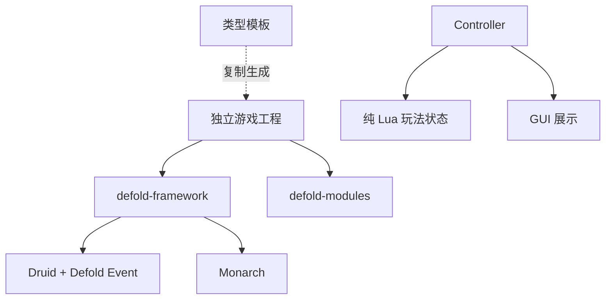

# Defold Framework V1 工程实施规范

日期：2026-11-18。状态：实施基线；M0 单页面桌面/HTML5 已验证，后续能力待实现。

本规范把用户的 [原始方案](../references/studio-proposal.md) 转成可执行工程约束。模块接口见 [API 合约](api-contracts.md)，任务与验收见 [实施计划](../planning/implementation-plan.md)。本文的“必须”指后续实现要求，不代表功能已经存在。

## 1. 当前状态与目标

规划起点：`game-framework` 是平台跳跃模板，入口 `/game/game.collection`，一个玩家脚本、一张地图。当时无框架、GUI 或第三方库依赖。规划时仅落地实施文档；M0 现已添加 examples/ui_demo 入口与固定依赖。旧项目路径已不存在，不在旧路径重建工程。

目标：每款游戏独立构建和发布；公共能力通过版本固定的 Library Project 复用；模板复制后独立演进。第一条产品线为经营类，平台跳跃代码保留作为既有示例。Framework V1 的验收以 UI Demo 和独立消费工程为准，完整经营游戏不作为基础库发布的前置条件。

| V1 必须交付 | V1 边界 |
|---|---|
| Core、EventBus、日志 | 服务生命周期、订阅释放、错误可定位 |
| UI、主题、适配 | Druid 控件、Monarch 导航、基础业务组件 |
| Save / Migration | 本地保存、逐版迁移、失败恢复 |
| Audio、Settings | 音乐/音效分组与持久化设置 |
| Localization | 简体中文/英文、缺失键回退、字体资源 |
| Platform、Ads | 浏览器/桌面基础适配、模拟广告及无广告适配器 |
| Analytics | 可替换接口、开发日志实现 |

V1 不包含真实广告平台上线、移动端商业 SDK、内购、网络、云存档、热更新、3D 系统。iOS/Android 保留接口和构建接入点，不能据此宣称真机兼容已验证。首个真实 H5 平台在产品接入阶段选择，Poki/CrazyGames/Playgama 不同时接入。

## 2. 仓库与依赖边界



- 当前目录先作为框架开发根目录；后续仓库名可以是 `defold-framework`，无需现在移动文件。
- 导出目录只使用 `framework`；玩法库只导出 `game_modules`，防止与游戏的 `game/`、`assets/` 或其他依赖冲突。
- Framework 不依赖玩法库。玩法库不依赖 Framework、Defold GUI 或平台 SDK；时钟、随机源、事件通知通过参数传入。
- 模板复制公共库依赖清单和项目骨架，不复制公共库实现；实例记录模板版本，但不自动接受模板升级。
- 先维护两个公共库。只有一个真实模块需要交付时才创建玩法库，避免空仓库和空模块。
- 每个消费工程显式列出直接需要的依赖，检查资源闭包；不假设公共库自己的 `game.project` 会替消费工程配置输入、渲染、字体和平台设置。

未来框架目录：

```text
framework/
  core/          app.lua、event_bus.lua、pause.lua
  ui/            ui_manager.lua、screen.lua、theme.lua
    components/  按钮/进度条/货币栏/卡片对应的 .gui + .lua
    assets/      公共图集、字体、材质
  save/          save_manager.lua、migration.lua、storage.lua
  data/          localization.lua
  platform/      platform.lua、adapters/
  monetization/  ads.lua、adapters/mock.lua、adapters/unsupported.lua
  services/      audio.lua、settings.lua、analytics.lua
  debug/         logger.lua
examples/ui_demo/ 主入口、屏幕、配置和演示资源；不导出
examples/platformer/ 未来整理既有示例；须同步修复资源引用
 tests/         纯 Lua 和引擎集成测试；不导出
 scripts/       获取依赖、构建、运行、打包、收集证据
 docs/          架构、任务、使用说明、验证记录
```

独立消费验证工程在 M5 创建于同级目录，用实际 Library ZIP 测试，不依赖框架目录的源码遮蔽。远程仓库尚未建立时可用本地 HTTP 提供打包产物，不写不存在的 GitHub 地址。

## 3. 版本基线与 Library 配置

候选组合：本机 Defold **1.14.1**、Druid **1.3.0**、Monarch **6.0.3**、Defold Event **21**。具体提交和 ZIP URL 已记录于 [dependencies.json](../planning/dependencies.json)。这份文件是本项目的规划清单，Defold 不会自动解析；M0 的脚本将其写入项目依赖配置并检查漂移。

本机 Editor 的 engine SHA 已取证。Bob 必须匹配同一引擎版本和 SHA；下载后记录校验值及 Java 需求。没有构建结果前，这组版本只算候选基线。M0 已完成桌面与 Web 单页验证，详见验证记录。

Druid 1.3.0 的 README 引用 Event 16，但该 tag 的 `game.project` 引用 Event 21；初步选 21 对齐示例工程，M0 验证按钮、事件注销与控件销毁。失败时调查版本源码并更新清单，不直接升级至 master。

公共库未来配置：

```ini
[library]
include_dirs = framework
```

消费工程的 `[project] dependencies#N` 使用清单中的提交 ZIP URL；公共库版本号从 `0.1.0` 起，达到 V1 验收后才标记 `1.0.0`。标签、提交、构建工具版本和构建报告同时归档。公共资源引用只能指向导出目录、明确依赖或 builtins。

## 4. Collection、GUI 与导航

```text
main.collection（常驻）
├── bootstrap.go + bootstrap.script（服务与启动）
├── home_route.go + collectionproxy + Monarch screen_proxy.script
├── components_route.go + collectionproxy + screen_proxy.script
├── settings_route.go + collectionproxy + screen_proxy.script
└── dialog_route.go + collectionproxy + screen_proxy.script（popup）
    └── 对应 screen.collection
        └── view.go + screen.gui
            └── screen.gui_script → Druid 控件与本游戏 Controller
```

V1 统一采用顶层 sibling proxies：所有路由注册在常驻 Collection，避免 proxy 下再嵌套有独立输入的屏幕。每个页面三件套为 `.collection + .gui + .gui_script`。公共小组件用 GUI template + Lua 封装，不为每个按钮创建 Collection。

Monarch 是唯一导航栈；`ui_manager` 只包装路由验证、转场请求、重复请求处理和错误报告。`scene_manager` 如保留名称，仅转发同一管理器，不能再维护另一份栈或直接卸载 Monarch 管理的 proxy。

首屏显示延迟到路由注册完成后的消息阶段。路由定义固定 ID、popup 标志和资源引用；运行时使用 ID，不拼接任意资源路径。转场期间拒绝新的导航请求并返回 busy，失败必须解除 busy。GUI 释放时注销订阅、取消异步请求和调用 Druid final。

Monarch 负责路由层输入焦点，Druid 负责页面内控件输入；页面 lifecycle 转发 Druid 的 update/on_message/on_input/final，并按所选版本核对自动获取焦点行为。模态弹窗阻断下层输入。多个弹窗的顺序由 Monarch 管理。Toast 使用固定 overlay，默认不拦截输入。

暂停通过 token/reason 集合管理：弹窗、广告、失焦分别持有暂停原因，只有全部释放才恢复。Controller 决定哪些模拟暂停；经营生产的后台时间推进策略显式配置，不因打开设置页就意外改变经济收益。

## 5. UI 主题与屏幕适配

布局由 `.gui` 定义，Lua 负责状态与交互。Druid 提供控件行为；Monarch 提供页面和弹窗管理。统一主题提供颜色、字号角色、间距、资源 ID 和动画时长。

`radius = 12` 只是设计 token，不能直接赋给 Defold GUI 形成圆角。V1 用九宫格贴图实现面板和按钮，主题将 radius/style 映射到实际图集动画；复杂动态圆角材质后置。颜色字符串在主题加载时转换，组件仅接收已验证颜色。字体必须预先注册，中文字符覆盖和英文文本长度单独检查。

UI Demo 采用 960×640 逻辑参考画布，与当前窗口一致；重点验证 16:9、4:3、9:16 与窄窗口。外层背景可扩展，内容区依据 safe area 和 GUI layout 调整，不能单纯非等比拉伸。经营模板以后选择自己的默认方向，不将 Demo 横屏尺寸固化为框架规则。

先交付 Button、ProgressBar、CurrencyBar、ItemCard、ConfirmDialog、Toast、Tab 与滚动列表。组件只暴露数据、状态与回调，不能直接扣钱、写存档或调用广告 SDK。

## 6. 状态、事件与持久化

玩法 state 是 Controller 持有的纯 Lua table；GUI 展示快照并发送意图。同步业务调用返回明确结果，事件仅广播已发生的事实。EventBus 绑定 app 实例，订阅返回释放函数；页面隐藏或销毁按实际订阅周期释放。

不能从任意 EventBus 回调直接操作 GUI：回调可能运行在发起者的 Defold script context。通过 `msg.post` 将更新送到 GUI 自己的 `on_message`，或在 GUI update 中消费待更新快照。纯 Lua 测试不得调用 gui/go/msg。

存档 envelope 包含 schema_version、revision、saved_at、payload。只允许可序列化的普通数据；资源节点、函数、URL userdata 等不进入存档。框架迁移 envelope，游戏提供 payload 迁移和校验函数。升级失败保留原档，不用默认值覆盖；发现未来版本则拒绝覆盖并返回版本错误。

Storage adapter 隔离 Defold 保存机制。设计主备槽和 revision，读取时选择有效的较新版本；写入失败不报告成功。HTML5 要分别验证首次读取、刷新恢复、存储不可用与浏览器清理后的默认值行为；不承诺仅关闭页面时保存即可可靠落盘。设置变化、业务检查点和限频周期触发保存。

## 7. 平台、音频与商业化边界

Platform 提供 capability 查询，桌面/普通浏览器无广告时返回 unsupported。Mock 广告只在显式开发配置中启用。广告结果包含 completed/cancelled/unavailable/error；只有 completed 允许游戏发奖励，并以 request_id 去重。超时、重复回调、页面销毁和并发请求必须覆盖。

框架只报告广告结果，奖励由游戏 Controller 计算与提交。真实 SDK 在独立平台适配包接入，不能使无广告游戏携带全部平台插件。移动端内购需要另一套购买/恢复流程，不复用奖励广告接口。

Audio 通过宿主注册的 sound URL 工作，音乐和音效分别调节；浏览器首次用户交互前保留待播放意图。暂停/广告结束恢复用户原音量，不强制取消用户静音。Analytics 默认仅输出事件日志，真实发送适配器后置。

## 8. 决策与仍需证据的事项

| 决策 | 理由 | 验证位置 |
|---|---|---|
| Library 导出 framework/game_modules | 防资源命名冲突，检查消费侧引用 | M5 |
| Monarch 单一导航栈 | 避免加载、返回、输入状态分叉 | M1 |
| GUI 模板 + Druid 控件 | 复用布局与交互，保留编辑器预览 | M2 |
| 实例 state + adapter 注入 | 方便纯 Lua 测试和平台替换 | M1/M3 |
| UI Demo 优先、构建工具同步接入 | 在玩法扩展前暴露引擎约束 | M0–M2 |

待验证：依赖组合兼容性、HTML5 存储失败行为、浏览器音频解锁、不同屏幕比例和中文字体。待产品决策：首个 H5 聚合平台、真实经营游戏主题、品牌 UI。后者不阻塞基础 Demo。

## 9. 核对来源

- [Defold Library 手册](https://defold.com/manuals/libraries/)：导出目录、固定版本及资源引用边界。
- [Druid 1.3.0](https://github.com/Insality/druid/tree/1.3.0)：控件与 GUI template 组合；版本依赖以该 tag 源码核对。
- [Druid 1.3.0 game.project](https://github.com/Insality/druid/blob/1.3.0/game.project)：最低引擎要求与 Event 21 依赖记录。
- [Monarch 6.0.3](https://github.com/britzl/monarch/tree/6.0.3)：screen proxy、导航、输入焦点与 popup 配置。
- [Defold 1.14.1](https://github.com/defold/defold/releases/tag/1.14.1)：引擎版本；本机配置另见版本清单。
