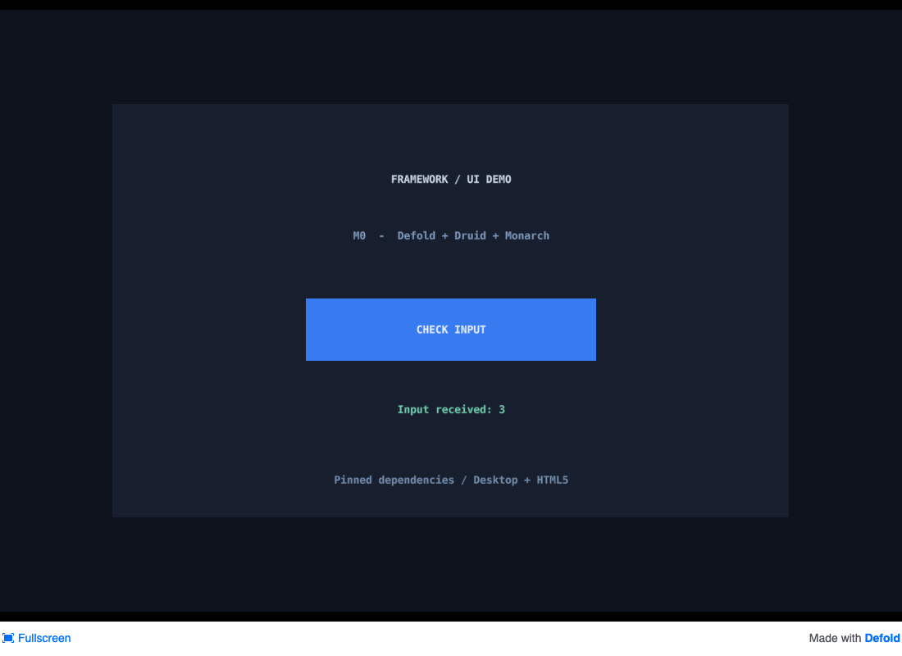

# M0 验证记录

日期：2026-11-18（Asia/Shanghai）。环境：本机 macOS / Apple Silicon，Defold 与 Bob 1.14.1，engine SHA `ee283d4dad9fa451dd6399d83602e1dc25133681`，Defold 自带 JDK 25.0.4.1+1。

## 已通过

| 项目 | 证据 |
|---|---|
| 固定版本与完整性 | dependencies.json 记录 3 个库的 commit/ZIP SHA-256、Bob SHA-256；check-deps 退出 0 |
| 空库缓存重新获取 | 将当前 3 个 ZIP 缓存移出后，Bob resolve 一次成功，校验和一致，后续 build 退出 0 |
| 桌面构建与打包 | bundle-desktop 退出 0，原生扩展 arm64/x86_64 均成功 |
| 桌面实际运行 | integration 退出 0；日志包含 M0_BOOT、M0_READY、M0_INPUT 1、M0_GUI_FINAL；无 ERROR |
| Event 兼容性 | 实际引擎中 subscribe → trigger → unsubscribe → trigger，回调只执行一次 |
| 依赖漂移保护 | unit 退出 0；测试修改依赖后必须报错，同步恢复且保留其他配置、可重复同步 |
| HTML5 打包 | bundle-html5 退出 0；Web 原生扩展成功生成 |
| HTML5 运行 | 本地 HTTP + 无界面 Chrome 实际启动，3 次点击计数为 3，刷新后再次 ready，无页面异常或 Lua 脚本错误 |
| 视觉检查 | 已检查下图：面板、文本、按钮与计数可见，无遮挡；仅覆盖此截图尺寸 |

工具入口和重现命令见根目录 README。完整本地日志位于 `logs/m0/`（构建缓存和日志不入版本库）。桌面调试 app 约 15 MiB，HTML5 调试目录约 7.7 MiB；不是压缩传输大小或正式发布预算。

## 修复与界限

- GitHub 归档下载出现短暂失败，改用相同 commit 的 codeload 地址；增加已验证缓存复用和限次 resolve 重试。
- 从工程根目录直接运行二进制会加载旧 build/default。集成入口现从应用 Resources 启动，日志确认加载 archive:game.dmanifest。
- 浏览器自动点击最初按下/释放间隔过短，未被引擎分帧采样。测试使用 120 ms 按压，真实点击路径通过；没有为通过测试修改游戏输入逻辑。
- 桌面点击为直接调用 Druid 输入接口的确定性检查；浏览器检查覆盖真实鼠标 → 引擎 → GUI → Druid 路径。
- 依赖组合只验证 M0 单页面使用；多页转场、弹窗、30 次导航循环、屏幕适配和触摸设备留给 M1/M2。
- 未验证 iOS、Android、真实广告平台、Safari，也未进行发布签名或商店提交。
