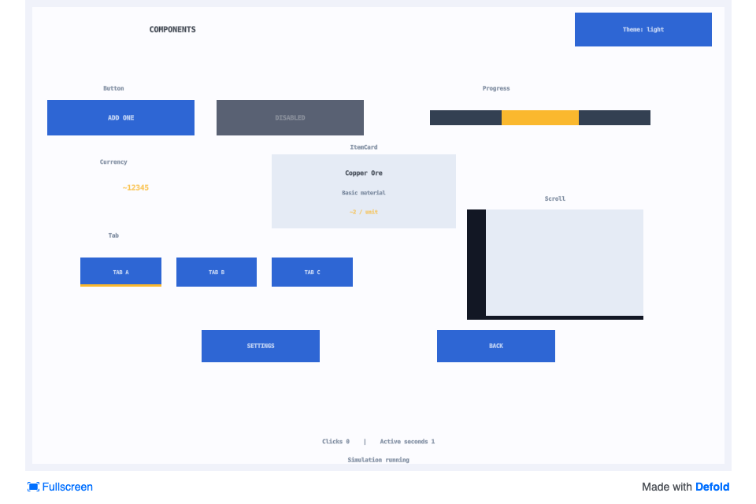
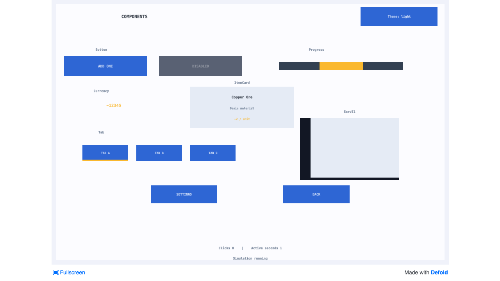
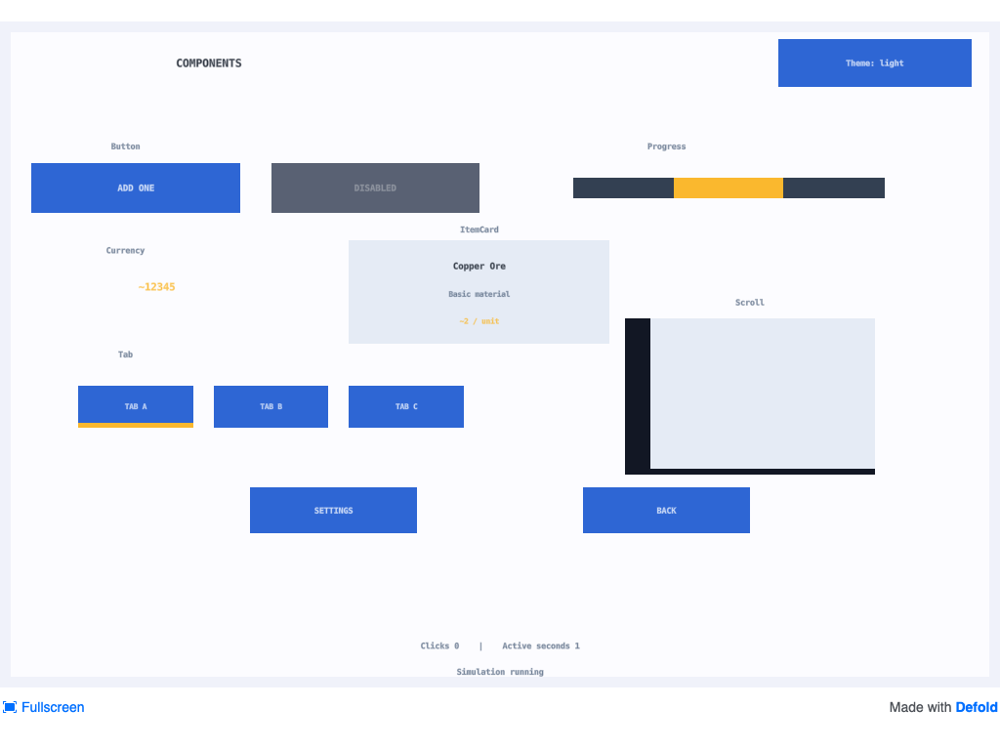
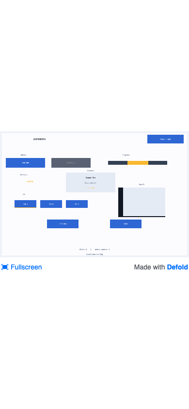

# M2 验证记录

日期：2026-11-18（Asia/Shanghai）。环境：本机 macOS / Apple Silicon，Defold 与 Bob 1.14.1，engine SHA `ee283d4dad9fa451dd6399d83602e1dc25133681`。

M2 边界：在 Druid 之上封装可复用业务组件，统一主题（亮/暗），Demo 展示各组件正常/禁用/边界状态；屏幕比例变化时保持可操作区域，不做非等比拉伸。组件只暴露数据、状态与回调，不触碰经济、存档或广告逻辑。

## 产物

- `framework/ui/theme.lua` — 主题系统，亮/暗两套 token（背景、表面、文字、主色、强调、危险、成功、边框、遮罩），`validate` 接受预设名或 token 表，`apply` 在所属 GUI context 内按绑定改色。
- `framework/ui/components/button.lua` — 封装 Druid 按钮，`set_enabled`/`set_label`。
- `framework/ui/components/progress_bar.lua` — 封装 Druid 进度条，`set_value` 做范围钳制。
- `framework/ui/components/currency_bar.lua` — 只展示金额，`set_value` 带符号/格式化。
- `framework/ui/components/item_card.lua` — 卡片标题/副标题/价格/图标，可选 `on_select`。
- `framework/ui/components/confirm_dialog.lua` — 确认/取消两键，`on_confirm`/`on_cancel`。
- `framework/ui/components/toast.lua` — 非拦截式提示，`show`/`update` 定时隐藏。
- `framework/ui/components/tab.lua` — 单选标签组，`set_active`/`on_change`。
- `framework/ui/components/scroll.lua` — 封装 Druid 滚动，`scroll_to`/`get_percent`。
- `examples/ui_demo/` — components 页展示全部组件，`theme` 消息切换主题。
- `scripts/check-m2.mjs` — 四尺寸 HTML5 截图脚本。

## 已通过

| 项目 | 证据 |
|---|---|
| 四尺寸截图 | 960×640、1280×720、1024×768、390×844 均截图成功，无 ERROR |
| 主题切换 | 点击 Theme 触发 `M2_THEME light`，重刷整屏不重建业务状态（Clicks/Active seconds 保留） |
| 控件不遮挡 | 逐张检查，Button/Progress/Currency/ItemCard/Tab/Scroll/Settings/Back 分区清晰无重叠 |
| 无点击偏移 | 四尺寸均通过真实鼠标点击进入 components 页并切换主题 |
| 竖屏适配 | 390×844 下 fit 等比缩放居中，内容完整无裁切、无变形 |
| M1 回归 | `M1_INTEGRATION_PASS cycles=30`、`M1_SHUTDOWN listeners=0`，退出码 0 |

截图文件：






## 修复与界限

- `[html5] scale_mode` 由 `stretch` 改为 `fit`：`stretch` 非等比拉伸会导致窄竖屏下 960×640 画布横向溢出、按钮被裁切；`fit` 保持 1.5 宽高比、letterbox 居中，符合"不做非等比拉伸"的要求。
- 组件层直接复用 Druid 1.3.0 内建能力（`new_button`/`new_progress`/`new_scroll`），未重造底层交互；九宫格圆角沿用 Druid 图集约定，未单独生成 PNG。
- 主题目前覆盖 components 页的 background/surface/card/scroll/文字等节点；home/settings/dialog 仍用固定深色（后续统一主题时补齐）。
- 390×844 竖屏下横屏参考画布内容等比缩小，文字较小，属横屏画布的自然结果；移动端竖屏专属布局未在本次范围内。
- 中英文字体授权与字符覆盖（M2 验收中的字体项）依赖 `builtins/fonts/default.font`，中文字符覆盖留给 M3 Localization 统一验证。

## 重现

```sh
python3 scripts/project.py bundle-html5
python3 scripts/project.py serve   # 保持运行
node scripts/check-m2.mjs
```

完整运行日志在 `logs/m2/`，截图在 `docs/verification/m2-*.png`。
